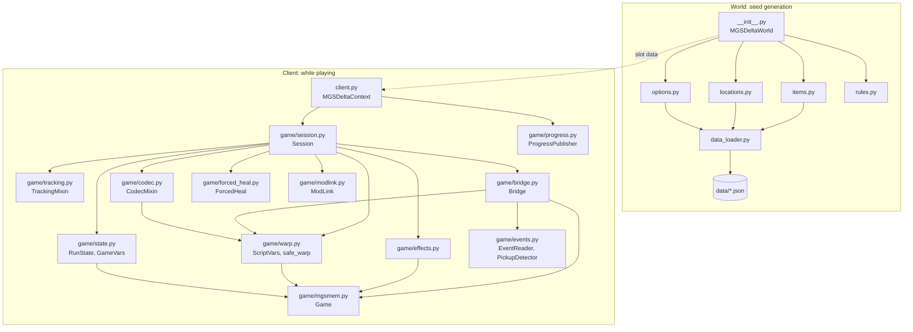

# The APWorld (Python)

Everything in `apworld/mgs_delta` ships in `mgs_delta.apworld`. It has two halves:

- **The world** (top folder): used by Archipelago when it generates a seed. It builds the items, the locations, the
  regions and the rules.
- **The client** (`client.py` and `game/`): the "MGS Delta Client" in the Archipelago Launcher. It runs next to the game
  while you play.

## The world

### `__init__.py`: `MGSDeltaWorld`, `MGSDeltaWeb`
The Archipelago world. `MGSDeltaWorld` checks the options (`generate_early`), makes one region per story section in a
chain (`create_regions`), fills the item pool (`create_items`: the items the logic needs, then extra weapons and gear,
then benefits and traps as filler), sets the rules, and writes the slot data the client needs (`fill_slot_data`: the
options, the sections and which items count for each check type). It refuses to generate if there are more required
items than checks. `MGSDeltaWeb` holds the setup guide entry. The file also adds the client to the Launcher.

### `items.py`: `MGSDeltaItem`
The item tables. Game items come from `data/items.json`, plus the clearances (Cave Exit, Sokrovenno Exit), the C3
Charges, the benefits and the traps. Each gets an Archipelago id and a classification (progression, useful, filler,
trap). `MGSDeltaItem` is the item class.

### `locations.py`: `MGSDeltaLocation`
The location tables: chapters, bosses, "New Weapon 1, 2, ..." style acquisition checks (or bundles), Kerotans, Gako,
animals, no-alert areas and CQC takedowns. Which ones exist depends on the options. The helpers here work out how
many acquisition checks each section can give (the "acquisition plan").

### `options.py`
All YAML options, each with its explanation (difficulty, loadout, starting camo, check types and counts, bundles,
locks, traps, DeathLink, ...). It also holds the trap and benefit lists.

### `rules.py`
The logic. Sections are played in story order. Entering a section needs the previous one, plus its unlock if it has
one: a clearance, or a count of an item (the 4 C3 Charges before Volgin). Boss fights need a way to fight (any firearm,
or an explosive or fire weapon). The Revival Pill is needed after The Sorrow.

### `data_loader.py`
`load(name)` reads a JSON file from `data/`. It works inside the zipped `.apworld` too.

## The client

### `client.py`: `MGSDeltaContext`, `MGSDeltaCommandProcessor`
The Archipelago side. `MGSDeltaContext` is a `CommonContext`: it connects to the server, receives items, and sends
checks, the goal and DeathLinks. `game_watcher` runs the game loop every 50 ms and feeds `Session`.
`MGSDeltaCommandProcessor` adds the client commands `/game`, `/goal` and `/startrun`.

### `game/session.py`: `Session`, `TickResult`
The heart of the client: the run logic, with no networking in it. Each `tick()` reads the game and returns a
`TickResult` (checks to send, the goal, a DeathLink). It handles the run start (wipe and loadout), new finds and
take-backs, received items and regrants, locks and bounces, masking at area loads, the C3 Charges, story gifts, bosses
and the goal. See [How the game works](game-research.md) for why each of these exists.

### `game/tracking.py`: `TrackingMixin`
The counters that are their own checks: no-alert areas, Kerotan frogs, Gako ducks, captured animals and CQC
takedowns. It is mixed into `Session`. It also installs and removes the Kerotan block (see the research page).

### `game/codec.py`: `CodecMixin`
Builds the codec pages (status, locks, goal, warp list) and handles codec warps: a call to an unlocked warp frequency
prepares the warp, and the warp runs once the codec is closed. Mixed into `Session`.

### `game/bridge.py`: `Bridge`
The game-facing tools. It reads both inventory tables once per tick, so every step of that tick sees the same inventory, and remembers what the client wrote itself, so a change it
sees later was made by the game. It matches pickup events to box locations (same area, same box model, nearest
position). It does the masking at area loads, clears box respawn timers and reads the "next stage" value.

### `game/effects.py`
Traps and benefits. `apply_effect()` runs one (memory writes, or a mod command for weather, injury, disarm and camo),
and `tick()` handles timed ones (temporary Stealth Camo, the weather restore, the held caution).

### `game/events.py`: `EventReader`, `PickupDetector`
`EventReader` reads new lines from `events.jsonl`. `PickupDetector` decides if a box that ended was picked up or just
unloaded with the stage: when a stage unloads every box ends and a `stage` event follows. So ended boxes wait up to
4 s; a `stage` event in that time means unload, no `stage` event means pickup.

### `game/forced_heal.py`: `ForcedHeal`
Two story scenes can't be finished without cure items: the Virtuous Mission river bank (Snake must treat his wounds)
and EVA after the sidecar crash in Zaozyorje. Since the run start removes medicine, the client fills the cure items
during those scenes and puts the old counts back afterwards.

### `game/mgsmem.py`: `Game`
Opens the game process and reads and writes its memory (`ReadProcessMemory` / `WriteProcessMemory`). It knows the two
inventory tables. Addresses are adjusted to where Windows loaded the game (ASLR).

### `game/modlink.py`: `ModLink`
Writes commands to `commands.jsonl`. Popups are held in a queue and only sent once Snake is in play, because text shown
during a load or a cutscene is lost.

### `game/warp.py`: `ScriptVars`, `safe_warp`
`ScriptVars` reads and writes the legacy script variables (`$var`, stored big-endian like on the PS2). `safe_warp` lands
Snake at a real door: it writes the door's position and gate first, then asks the mod to load the stage.

### `game/state.py`: `RunState`, `GameVars`
`RunState` is the saved state of a run, one JSON file per seed and slot (what was found, taken back, completed, the
highest story value, visited areas, counters). `GameVars` reads fields of the game-state block (life, stamina, story,
worn camo, ...).

### `game/progress.py`: `ProgressPublisher`
Publishes progress to Archipelago data storage (`mgsdelta_progress_<team>_<slot>`) for the PopTracker pack.

### `game/paths.py`
Finds the mod folder: the `MGSDELTA_GAME_DIR` variable, then every Steam library, then the default Steam path.

### `game/probe.py`: `EscapeProbe`
Read-only logging during the Capture and Escape section, to study how the game takes and returns Snake's gear.

### `game/constants.py`
Shared addresses, stage-name patterns and item id ranges.

## Data files (`data/`)

| File | What is in it |
|---|---|
| `items.json` | Every weapon, item, camo and face paint with its game id. |
| `locations.json` | Every item box: area, box model, position, the item inside, and its respawn timer. |
| `sections.json` | The story sections in order, their areas, unlocks and which items count as finds there. |
| `bosses.json` | Bosses: the story value that means "defeated", the arena, the non-lethal reward camo. |
| `checkpoints.json` | The codec warps: frequency, target stage, story value. |
| `exits.json` | Each stage's exit procs to its neighbours (used for lock bounces and connected-stage checks). |
| `entries.json` | Door positions and gates per stage (used for safe warps). |
| `kerotans.json`, `gakos.json` | The 64 Kerotans and 64 Gako ducks and their areas. |
| `animals.json` | Capturable animals and where they live. |
| `guarded_areas.json` | Areas with guards, for the no-alert checks. |
| `gamestate.json` | Offsets of game-state fields. |
