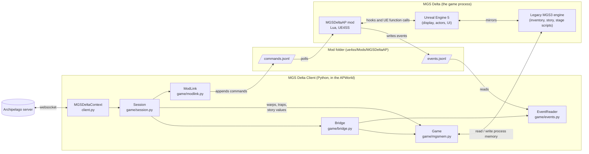
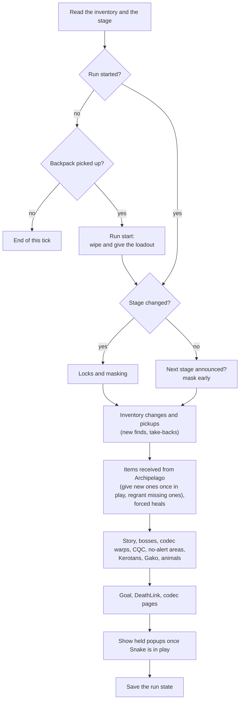
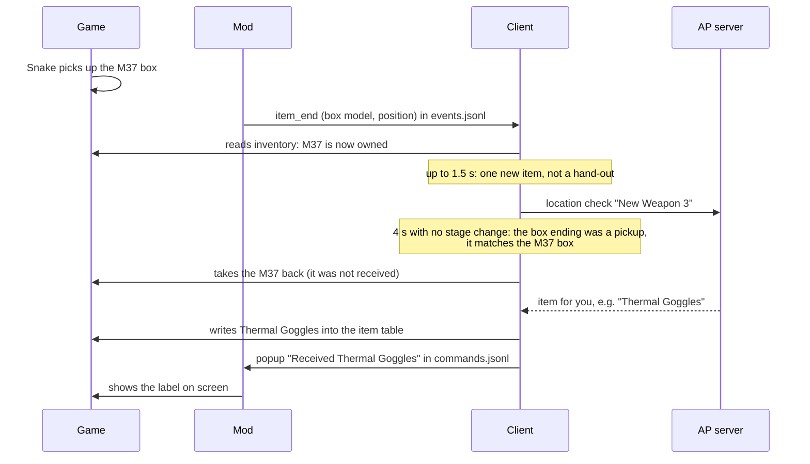

# Architecture

The randomizer has two parts:

- **The mod** (`ue4ss_mod/MGSDeltaAP`): Lua scripts that run inside the game through UE4SS. It tells the client what
  happens in the game and runs the few things that only work from inside Unreal.
- **The client** (`apworld/mgs_delta`): Python code that ships in the `.apworld`. It talks to the Archipelago server and
  holds all the logic. It also reads and writes the game's memory directly.

## How the parts connect

So there are three channels between the client and the game:

1. **Memory** (client to game, both ways): the inventory, life, stamina, the story value, warp positions and a few flags.
2. **`events.jsonl`** (mod to client): one JSON line per event, like an item box spawning or ending, a stage change, or a
   codec call.
3. **`commands.jsonl`** (client to mod): one JSON line per command, like showing a popup, running a stage proc, or
   changing the weather.

## One tick of the client

The client checks the game every 50 ms. Each check runs `Session.tick()`, which does the steps below in order.

## Example: you pick up a weapon

## Design decisions

**The mod only reports, the client decides.** All rules (what counts as a check, what to take back, which doors are
locked) are in Python. Lua under UE4SS is hard to debug, every hook runs in its own Lua state, and there are no
tests. Python has the Archipelago libraries, unit tests and a log. Keeping the mod small means fewer things break
inside the game.

**Files instead of a socket.** UE4SS Lua has no networking. Appending lines to a file works from every Lua state and
survives restarts on both sides. The mod remembers how far it read in `commands.offset`, so all of its Lua states share
one read position and a command never runs twice. On start, the mod skips commands left from the last session.

**The client writes memory itself.** No Unreal function gives or takes a single item. The game's inventory lives in
the legacy engine, in two plain tables (weapons and items), and Unreal only mirrors them. Writing those tables works at
once: the item can be equipped, fired, reloaded and saved like a normal one. The other way, a native C++ UE4SS mod,
is possible but would tie the mod to one UE4SS build. It is kept as an idea for later.

**The mod does what memory can't.** Showing text on screen, the codec pages, weather, wounds, refreshing the camo,
running a stage proc (doors) and loading a stage. These are Unreal functions, so they go through the mod.

**Offline only.** The client changes memory. Online that is cheating. See the disclaimer in the README.

**Doors, not teleports.** When the client must move Snake (a locked door, a codec warp), it runs the area's own exit
proc or writes a real gate position first. A bare stage load can put Snake under the map.

**Never take away what the story needs.** Some gifts are needed by scripted scenes (C3, RPG-7, SVD, Key C, disguises).
The client never takes those back, even when they would count as a find.

**The run state is saved per seed and slot.** Reconnecting, restarting the client or the game never repeats the
inventory wipe, never gives one-shot items twice and never counts a check again.
