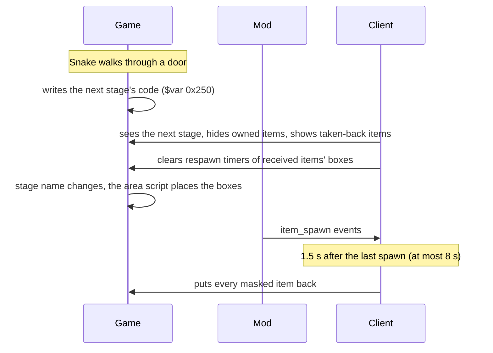
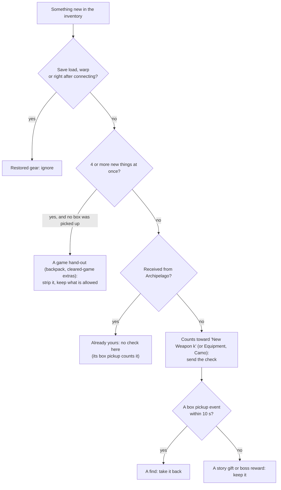

# How the game works

This page collects what we found out about MGS Delta while building the randomizer, and how the client uses it.
Most of it came from testing in game: trying different approaches, and watching how the game's memory changed while
we picked things up, walked through doors, loaded saves and called the codec.

## The inventory is two tables

The legacy engine keeps Snake's gear in two fixed tables in memory. Unreal only shows a copy.

| Table | One entry per | Fields the client uses |
|---|---|---|
| Weapons | weapon id (0-30: knife, pistols, rifles, grenades, C3, ...) | **stock** (-1 = not owned; for guns it includes the loaded rounds), maximum, rounds in the magazine, magazine size |
| Items | item id (equipment, medicine, boxes, ...) | **count** (0 = not owned), maximum |

Camos and face paints are items too: camos are ids 51-116, face paints 117-147.

Writing these fields from outside works right away. A weapon written into the table can be equipped, fired, reloaded
and saved like one found in the world. This is how received items are given, and how found items are taken back.

## How item boxes decide to appear

Each area places its boxes when it loads. By changing the inventory before entering areas and watching which boxes
showed up, we found these rules:

- **Equipment and camo boxes** only appear while Snake owns **none** of that item (count 0).
- **A weapon box becomes an ammo box** while Snake owns the weapon, even with almost no ammo
  left.
- **A weapon box is refused while the weapon is owned** ("M37 FULL"), whatever the stock.
- **Weapon, ammo, grenade and medicine boxes also have a respawn timer.** A box you picked up stays away for a while,
  even when its item is hidden. The client clears that timer for boxes that are still a check.
- Picking up an owned item at its maximum is refused ("FULL"). Below the maximum it is accepted, but a unique item
  doesn't change. So a pickup can't be seen from the inventory alone. That is why the mod reports box events.

This is a problem for a randomizer. If you receive the Thermal Goggles from another player before finding their box,
the box would never appear, and the check could never be found.

## Masking: hiding items while an area loads

The fix is to change the inventory **just before** the area script runs, and put it back after the boxes have
appeared. We call this masking.

- **Hide**: items you own (received from Archipelago) whose box is still a check here are set to 0. Their box appears.
- **Show**: items the client took back (you found them, but they were not yours) are briefly given. Their box then
  stays away (or becomes an ammo box), because that check is already done.
- **Weapons are not hidden.** Their box shows up as an ammo box, and picking up that ammo box counts the check.

**Timing was the hard part.** Masking when the stage *name* changes was too late now and then: the area script won the
race, and a box was missing or came as ammo. Recording the memory while walking through doors showed that the game
writes the next stage's code to a variable 0.3 to 0.8 s before the name changes (about 10 s early in the Virtuous
Mission). The client masks on that value instead, and the boxes appeared every time in testing.

**Putting items back.** A hidden item goes back to its count, but at most `maximum - 1`. At the maximum, the game would
refuse your pickup of that same box ("FULL"). For the same reason, in an area with an open box of an item you own, the
client raises that item's maximum by one, and lowers it again when you leave.

## Finds, take-backs and story gifts

Every tick the client compares what you own now with what it last saw. Its own writes are remembered, so a change it
sees was made by the game.

- **Pickup or unload?** When an area unloads, every box in it ends too. The mod reports both the same way. An unload is
  always followed by a stage event, so an ended box waits up to 4 s: a stage event means unload, none means pickup.
- **Matching a pickup**: the nearest known box in the area with the same box model, within 120 units. Boxes dropped by
  enemies are ignored.
- **Never take back a story gift.** Scripted scenes need some items: C3, RPG-7, SVD, Key C, Cigar Gas, Spirit Camo and
  the disguises. Taking them away could softlock the game.
- **Regrant**: every 2 s, received items that went missing are given again. Not during the Capture and Escape section,
  where the story takes Snake's gear on purpose.

## Camos

- Camos and face paints live in the item table. What Snake **wears** is two bytes in the game-state block.
- When the client changes the worn camo (run start, the Fashion trap), the look on screen doesn't change by itself.
  The mod then calls the camo manager's refresh (`camo_refresh`), which redraws Snake.
- The run start keeps the starting camo, the camo you are wearing and "No Paint". Taking away the worn camo would
  leave Snake in a camo he doesn't own.
- **Non-lethal boss camos** (Hornet Stripe, Spider, Moss, Fire, Animal) only appear after a non-lethal win. Their
  appearance is the "Defeat <boss> Non-Lethally" check. The game also keeps a flag per boss for that win, which the
  client reads too.
- **Moss and Spirit Camo** are only handed out while you own none, so in their areas the client hides your copy until
  the check is done.

## The run start

Nothing counts before the run starts. In the first area of the Virtuous Mission, the run starts once the game hands
out the backpack (or after 120 s there). Then the client:

1. wipes weapons and items (keeping the camos above),
2. gives the loadout from the options and the starting camo, and redraws the camo,
3. clears the Kerotan flags of this save,
4. saves the run state, so this never happens twice.

## Forced heals

The run start removes medicine. Two scenes can't be finished without cure items: Snake on the river bank at the end
of the Virtuous Mission (he must treat his fractures and cuts) and EVA after the sidecar crash in Zaozyorje. During
those scenes the client fills the cure items to the maximum, and puts the old counts back when the scene ends.

## Locks, bounces and warps

- **A lock** is a door you can't use yet. The client lets the locked area load, then runs that area's own exit back
  (a stage proc) and shows "Locked: needs X". Using the game's own door keeps Snake on solid ground.
- **No bounce after a cutscene or a one-way door.** Bouncing would replay the cutscene, and a plain warp can land under
  the map. Those sections are locked at the last safe door before them.
- **Boss doors rewind the story.** Walking back into a beaten boss's arena sets the story value back and restarts the
  fight. Fights stay replayable on purpose; their check is only sent once.
- **Codec warps** write the target door's position and the right story value first, then load the stage, but only once
  the codec is closed (warping under an open codec froze the game). A warp unlocks once you have been there and reached
  its story value.

## The C3 Charges (gate 3)

C3 only fits the four fuel tanks in the Main Wing, and the story only goes on once all four are planted. There is no C3
box: the game only gives C3 with the gear after the escape. So the client gives no C3 until all 4 C3 Charges are
received, then 4 minus the ones already planted. Planting some and warping back would lose them (the script resets the
tanks), which is why they come all at once.

## The codec as a menu

Calling a frequency with no contact shows "No response.". The mod swaps that text for the client's pages: 143.40 is the
status and 143.41 up to 143.54 are the chapter warps. These frequencies were picked from a range no in-game contact
uses. A page holds up to 4 lines, and pressing confirm shows the next one.

## Kerotan frogs

Shot Kerotans are kept twice: once in the save (one bit per frog) and once in your profile (the lifetime record). On a
profile that has beaten the game, a new game copies the profile's frogs into the save. That would count them as shot.
The client blocks that one copy command in memory (only while it runs, never in your profile), so only frogs shot in
this run count. Your profile is never written.

## Things that did not work

- The game's console `inventory` command only resets the whole kit with a stage reload. There is no command to give
  or take one item.
- The Unreal inventory classes have no function that gives an item. Their setters only change the copy on screen.
- Pop-up windows from the game's UI either block input or ignore free text, so notifications use the pickup label and
  the subtitle strip.
- Writing the alert phase from outside holds the caution display and music, but the guards don't search. The Alert trap
  is mostly cosmetic for now.
