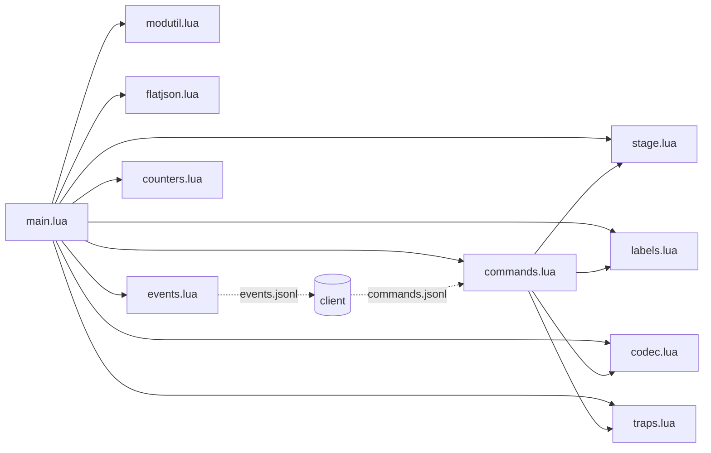

# The mod (Lua)

The mod lives in `ue4ss_mod/MGSDeltaAP/Scripts`. UE4SS loads `main.lua`, which loads the other scripts.

The mod has no game logic. It does two jobs:

- **Report** what happens in Unreal as events in `events.jsonl`.
- **Run** the commands the client writes to `commands.jsonl`.

## A quirk that shapes the whole mod

UE4SS runs each hook callback in its **own Lua state**. A variable set in one hook is not there in another hook. So
anything the mod must remember across hooks is kept in files (`commands.offset`, for example), and every module is loaded
once at the top of `main.lua`.

The mod checks for new commands from a loop every 200 ms and also when an actor begins play. The game's settings
turn off the engine tick hook, so `ExecuteInGameThread` never runs and can't be used.

## The scripts

### main.lua
The entry point. It loads every module, lists the event and command names, and maps each command to its handler
(`exec_proc`, `warp`, `popup`, `notify_clear`, `codec_menu`, `codec_set`, `disarm`, `weather`, `weather_restore`,
`injury`, `camo_refresh`). It sends a `hello` event on load, so the client knows the mod is there and re-sends the codec
pages. It starts the 200 ms loop and the BeginPlay hook that drive the polling.

### modutil.lua
Small helpers used by every module: the mod folder path, writing to the UE4SS log, checking that an Unreal object is
still valid, and finding the player controller and Snake's pawn.

### flatjson.lua
A tiny JSON encoder and parser. It only handles flat objects (no nesting), which is all the files need. It also maps
the JSON escapes, so a codec page break (`\f`) arrives as a page break.

### events.lua
Writes one event per line to `events.jsonl`. Every event gets a sequence number (`seq`) and a time (`t`).

### commands.lua
Reads new lines from `commands.jsonl` and runs them.
- **Shared read position.** The position is stored in `commands.offset` (always 20 characters, so it can be rewritten in
  place). All Lua states read and write the same position.
- **Never twice.** The position is saved *before* a command runs. If a handler fails, the command is not repeated.
- **Waiting commands.** `exec_proc` and `warp` wait while the codec is open (loading a stage under an open codec froze
  the game). They are dropped after 15 s, or after the command's own `ttl`.
- `notify_clear` waits until the message has been on screen for at least 3 s.
- On load, commands left over from the last session are skipped.

### stage.lua
Everything about stages and item boxes.
- Reads the current stage from `UE4PairingLevelManager` (`GetMGS3StageName`, `IsLoadingStage`) and sends a `stage`
  event when it changes.
- Sends `item_spawn` when an item box (`ibox_...`) begins play. Its `origin` is `placed` if it spawned within 2 s of the
  stage change (part of the area), else `dropped` (dropped by an enemy).
- Hooks the box's end of play (`BP_ibox_PropBase_C:ReceiveEndPlay`) and sends `item_end` with the box model, its
  position, whether a stage is loading and the end reason. The client decides if that was a pickup.
- `exec_proc` runs a proc of the loaded stage script (`Mgs3UtilLibrary:ExecMgs3Proc`). This is how the client uses a
  real door.
- `warp` loads a stage (`Mgs3LoadCmd(stage, "r_sna01")`). The client writes the landing position to memory first.

### labels.lua
On-screen text. There are three ways to show it:
- **Item label**: the same look as the game's pickup label (`ItemBoxBP_C:InitItemBox`), with ids from 900001 up,
  placed 300 units in front of the camera. White for normal messages, red for traps.
- **Caption**: the subtitle strip (`SubtitleWidget_C`), used for "Locked: needs ..." messages.
- **Log only.**

Clearing is stateless: it hides every id from 900001 to 900200 and empties the subtitle, so it works from any Lua state.
A warning shows as both a caption and a label. The console command `apnotify` is for testing.

### codec.lua
Turns the codec (radio) into the client's status screen.
- **143.40** shows the status (locks, goal) and the list of warps. **143.41 and up** are the chapter warps.
- These frequencies have no contact, so the game shows its one-line "No response." call. The mod catches that text
  (the `Radio_C` Blueprint's `OnShowMessage`) and shows the client's pages instead. A page is up to 4 lines.
- **Paging.** Pressing confirm normally ends the call. The mod undoes that press and shows the next page. Calling the
  same frequency again within 60 s also moves to the next page.
- `Radio_C` only exists once the codec has been opened, so the hook is set up late: the mod retries every 2 s, waits for
  the object to be created, and also tries from native radio functions that run while the codec is open.
- Sends `codec_call` (which frequency) and `codec_closed` (once, 2 s after closing). Warps are sent only after the codec
  is closed.

### counters.lua
Two hooks for checks that have no counter in memory.
- **CQC**: `GsrPlayerCqcAction:OnProcessCommunication` fires every frame while Snake holds someone. The mod sends one
  `cqc` event per hold, a new one after 1.5 s of quiet.
- **Gako ducks**: `GakoComponent:GakoSetCollected` fires when a duck breaks. The mod sends its `GakoIndex`.

### traps.lua
The traps and benefits that need Unreal.
- **Disarm**: `GsrPlayer:ChangeWeaponSlot(0)` puts the weapon away.
- **Weather**: `BP_Weather_System_C:SwitchWeather(type, true)` changes the visible weather. The old weather is saved per
  stage and `weather_restore` puts it back.
- **Injury**: adds a wound through the game's debug-menu callback (`CallbackAddPlayerWound`). The mod builds the menu's
  value object, sets the wound type and calls it. It tries an existing menu object, then the class default object, then
  a new object. Wound types: 1 burn, 2 cut, 3 bullet, 4 shotgun, 6 bee, 7 leech, 8 arrow, 9 needle.
- **Camo refresh**: after the client writes the worn camo and face paint to memory, Snake's look must be redrawn.
  The mod calls `UpdateCamouflageByNoPairing(facepaint, camo)` and `RefreshCamouflageBP(true, true, false)` on each
  camo manager.

## Events and commands

| Events (mod to client) | Meaning |
|---|---|
| `hello` | The mod has loaded. |
| `stage` | The stage changed. |
| `item_spawn` | A box appeared (`placed` or `dropped`). |
| `item_end` | A box went away (picked up, or unloaded with the stage). |
| `codec_call`, `codec_closed` | A frequency was called; the codec was closed. |
| `cqc` | One CQC hold. |
| `gako` | A Gako duck broke (`index`). |

| Commands (client to mod) | Meaning |
|---|---|
| `exec_proc` | Run a stage proc (a door). |
| `warp` | Load a stage. |
| `popup`, `notify_clear` | Show or clear text. |
| `codec_menu`, `codec_set` | Set the codec pages. |
| `disarm`, `weather`, `weather_restore`, `injury`, `camo_refresh` | Traps and the camo redraw. |
